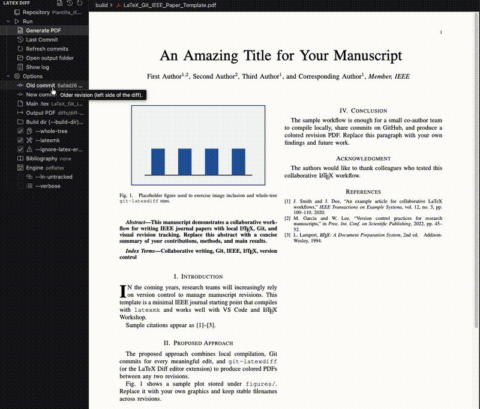

# LaTeX Diff for VS Code

Compare two Git revisions of a LaTeX project and open a colored PDF. This is a native VS Code / Cursor extension: Activity Bar panel, editor title button, Quick Pick, Progress, and an Output channel. It runs `git latexdiff`; it does **not** ship TeX, Perl, or `git-latexdiff`.



Author: [Javier Noe Ramos Silva](https://github.com/NoeSilva13) (`NoeSilva13`).

## Requirements

On your `PATH`, these should succeed in a terminal:

```bash
git --version
git latexdiff --help
pdflatex --version
latexmk --version
```

Install `git-latexdiff` from [GitLab](https://gitlab.com/git-latexdiff/git-latexdiff), Homebrew (`brew install git-latexdiff`), TeX Live / MiKTeX, or your package manager. Restart VS Code / Cursor after installing so it sees the updated `PATH`. On macOS with MacTeX, `/Library/TeX/texbin` must be on `PATH`.

## Install

The extension is **not** on the VS Code Marketplace yet. Install the `.vsix` from GitHub.

### From a GitHub Release (recommended)

1. Open [Releases](https://github.com/NoeSilva13/latex-diff/releases) and download `latex-diff-0.1.3.vsix` (or the latest `.vsix`).
2. In VS Code or Cursor: Command Palette → **Extensions: Install from VSIX…**
3. Select the file and reload the window.
4. Open a LaTeX project that is a **Git** repository. Both the Old and New revisions must contain the main `.tex` file.

### Build the VSIX from source

```bash
git clone https://github.com/NoeSilva13/latex-diff.git
cd latex-diff
npm install
npm run compile
npm run package
```

That writes `latex-diff-0.1.3.vsix`. Install it with **Extensions: Install from VSIX…** as above.

To develop without packaging: open this folder, press **F5** (Run Extension), then in the Extension Development Host open a real LaTeX Git repo.

## Example project

Clone [collaborative-latex-git](https://github.com/NoeSilva13/collaborative-latex-git) for an English Win/Mac/Linux install guide, an IEEE journal sample you can replace with any template, and a clone-and-compile Git workflow that uses this extension.

## Use

You do not need the Command Palette for everyday use.

1. Click the **LaTeX Diff** icon in the Activity Bar (left).
2. Under **Options**, set **Old commit**, **New commit**, **Main .tex**, and **Output PDF**. Toggle `--whole-tree`, `--latexmk`, and `--ignore-latex-errors`. Leave **Build dir** on Auto (see [Build directory](#build-directory)). Optionally set Bibliography, Engine, `--ln-untracked`, and `--verbose`.
3. Under **Run**, click **Generate PDF**.

The first time you open a repo, Old defaults to the previous commit and New to **HEAD**.

Also:

- Editor title **diff** icon, or right-click a `.tex` file: uses that file as `--main`, then generates with the panel’s Old/New.
- **Source Control** title bar: pick Old and New, then generate immediately.
- **Last Commit**: `HEAD` vs the working tree (uncommitted changes).
- **Refresh commits**: reload `git log` labels.
- **Open output folder** / **Show log**.

`--no-view` is always passed. The extension opens the PDF itself.

New revision choices include **HEAD** and **Working tree (uncommitted)**.

By default the PDF is `diffs/diff-<old>-<new>.pdf` under the repository root. Set a fixed name (for example `diffs/diff-output.pdf`) via **Output PDF** or `latexDiff.outputFile`.

A run often takes 30–90 seconds (`git latexdiff` compiles two trees). Watch **Output → LaTeX Diff**.

## Commands

| Command | What it does |
|---------|----------------|
| **LaTeX Diff: Generate PDF** | Run `git latexdiff` with the panel’s Old, New, and options |
| **LaTeX Diff: Compare Commits** | Pick Old and New, then generate |
| **LaTeX Diff: Last Commit** | `HEAD` vs the working tree (uncommitted changes) |
| **LaTeX Diff: Compare this file with…** | Set `--main` to the current `.tex`, then generate |
| **LaTeX Diff: Open output folder** | Reveal the output directory in Explorer |
| **LaTeX Diff: Show log** | Focus the **LaTeX Diff** output channel |
| **LaTeX Diff: Refresh commits** | Reload commit labels |

## Settings

Panel checkboxes and picks write **workspace** settings when a folder is open (so each paper can differ). You can also edit them in Settings.

| Setting | Default | Meaning |
|---------|---------|---------|
| `latexDiff.mainFile` | `""` | Main `.tex` relative to the repo root. Empty = auto (setting, then the active `.tex`, then a unique `\documentclass` file, then a picker) |
| `latexDiff.outputDir` | `diffs` | Output directory for revision PDFs |
| `latexDiff.outputFile` | `""` | Optional name inside `outputDir`. Empty = `diff-<old>-<new>.pdf` |
| `latexDiff.buildDir` | `""` | Folder where latexmk writes the PDF during the diff build (`--build-dir`), relative to the repo root. Empty = auto, from a `.latexmkrc` beside the main file. See [Build directory](#build-directory) |
| `latexDiff.wholeTree` | `true` | `--whole-tree` (needed when figures live outside the main file) |
| `latexDiff.latexmk` | `true` | `--latexmk` |
| `latexDiff.ignoreLatexErrors` | `true` | `--ignore-latex-errors` |
| `latexDiff.bibliography` | `none` | `none`, `bibtex` (`--bibtex`), or `biber` (`--biber`) |
| `latexDiff.engine` | `pdflatex` | `pdflatex`, `latex`, `xelatex`, `lualatex`, or `tectonic` |
| `latexDiff.lnUntracked` | `false` | `--ln-untracked` (new uncommitted figures) |
| `latexDiff.verbose` | `false` | `--verbose` |
| `latexDiff.extraArgs` | `""` | Extra flags, space-separated |

`extraArgs` is the escape hatch for flags that are not in the panel, including options forwarded to `latexdiff`. Examples:

```
--type=CHANGEBAR
--latexopt=-shell-escape
--cleanup none --tmpdirprefix ./diffs/tmp
```

Useful extras: `--subtree`, `--no-flatten`, `--latexdiff-flatten`, `--cleanup`, `--tmpdirprefix`, `--latexopt`, `--prepare`, `--filter`, `--latexpand`, `--ignore-makefile`, `--early-exit-if-equal`, `--ln-untracked-dir`. See `git latexdiff --help`.

Do not put `--view`, `--pdf-viewer`, or the Old/New revisions in `extraArgs`. `--no-view` is always added. If `extraArgs` already contains `--build-dir`, the extension does not add its own.

### Build directory

`git-latexdiff` does not compile in your project folder. It checks out the **New** revision into a temporary folder and runs plain `latexmk` there. That has two consequences:

- **LaTeX Workshop's `latex.outDir` does not apply.** latexmk reads no VS Code settings in the temporary folder, so a project that sets `"latex-workshop.latex.outDir": "%DIR%/build"` and has no `.latexmkrc` still gets its PDF next to the `.tex` file during the diff. The extension passes no `--build-dir` in that case, so the diff just works.
- **A `.latexmkrc` does apply**, but only the one in the main file's folder, and only if it is committed in the New revision. If it sets `$out_dir = 'build';`, the extension reads it and passes `--build-dir build` (or `--build-dir paper/build` when the main file is in `paper/`), so `git-latexdiff` looks for the PDF where latexmk wrote it.

`--build-dir` only tells `git-latexdiff` where to look for the PDF; it does not change where latexmk writes. So **Build dir** (`latexDiff.buildDir`) is an override you should rarely need: set it only if your `$out_dir` comes from somewhere the extension cannot read (for example a `~/.latexmkrc`), and clear it if you see `No PDF file generated` and the project has no `.latexmkrc`.

## Troubleshooting

| Symptom | What to try |
|---------|-------------|
| `git-latexdiff is not available` | Install `git-latexdiff`, confirm `git latexdiff --help` in a terminal, restart the editor |
| File does not exist in old revision | The Old commit predates that `.tex` file. Pick a later commit |
| Progress runs a long time | Normal. Use **Show log** |
| PDF missing after exit 0 | Open the log; the tool may have written a different path |
| `No PDF file generated` / `Expected PDF: …` | `git-latexdiff` looked for the PDF in a different folder than the one latexmk wrote to. No `.latexmkrc` in your project: clear **Build dir** (`latexDiff.buildDir`). A `.latexmkrc` that sets `$out_dir`: set **Build dir** to that `$out_dir`. See [Build directory](#build-directory) |
| Last Commit PDF looks empty | No uncommitted edits, or they match `HEAD`. Edit the `.tex` first, or pick two commits under Options |
| Bibliography unchanged | Set **Bibliography** to `bibtex` or `biber` |
| minted / TikZ shell tools fail | Add `--latexopt=-shell-escape` to `latexDiff.extraArgs` |

## Develop

```bash
npm install
npm run compile
npm test
```

| File | Role |
|------|------|
| `src/extension.ts` | Commands, progress, errors |
| `src/sidebar.ts` | Activity Bar tree |
| `src/config.ts` | Settings and `extraArgs` |
| `src/buildDir.ts` | `--build-dir` logic and the "No PDF" error text (no `vscode` import, unit tested) |
| `src/test/` | `node --test` unit tests (`npm test`) |
| `src/session.ts` | Stored Old/New revisions |
| `src/git.ts` | Repo root, log, `cat-file` checks |
| `src/latexdiff.ts` | Builds and spawns `git latexdiff` |
| `src/mainFile.ts` | Resolves the main `.tex` |

`npm run package` builds the VSIX (`out/` is compiled JavaScript; source stays in `src/`).

## License

[MIT](LICENSE) © Javier Noe Ramos Silva
